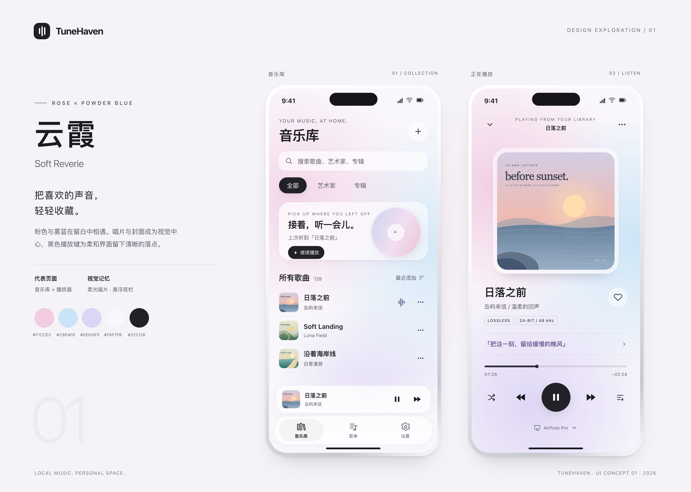
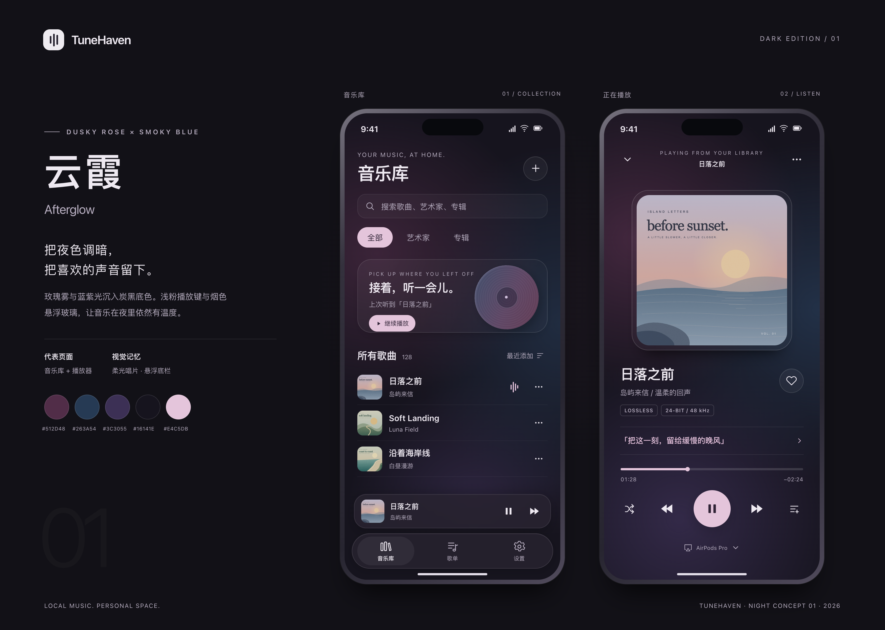
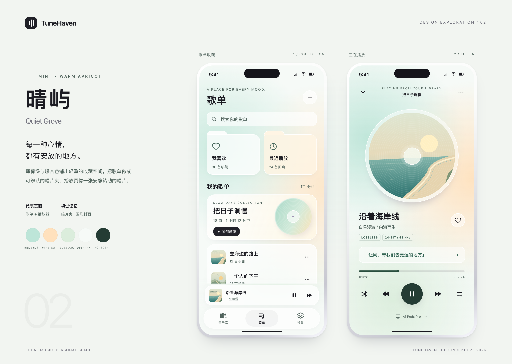
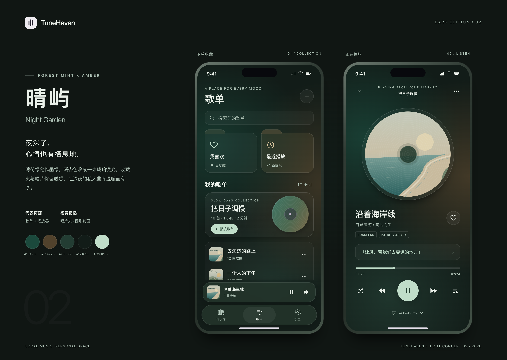
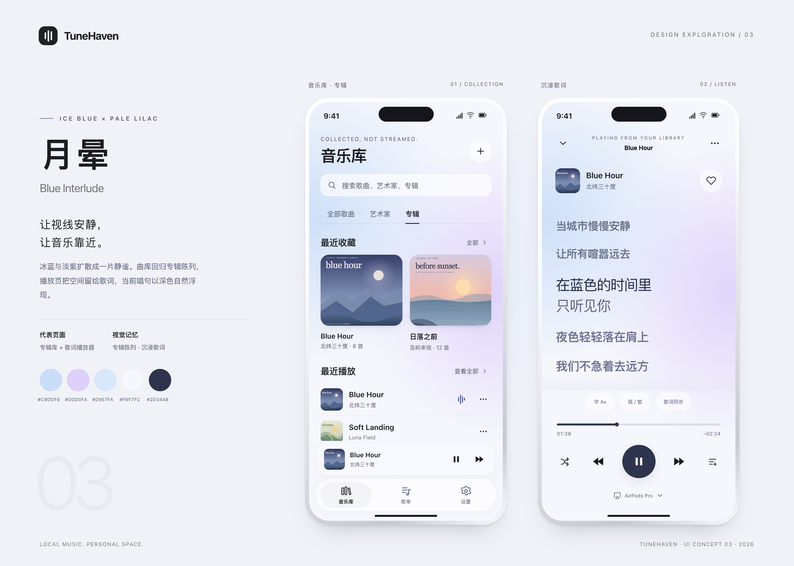
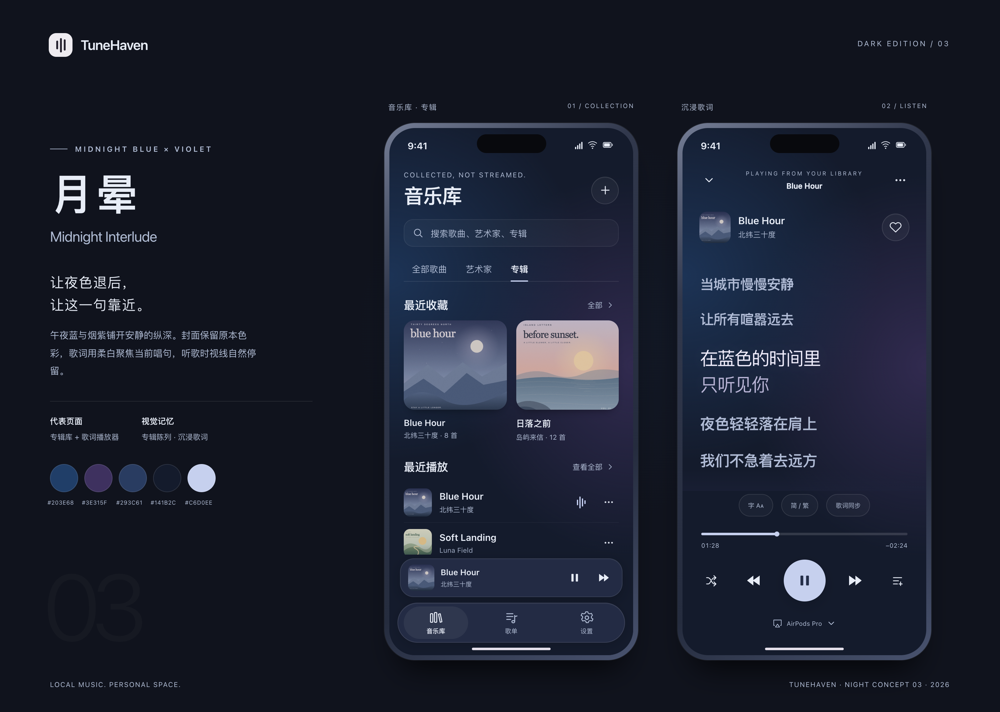

# TuneHaven UI 设计文档

> 版本：1.1 · 日期：2026-11-17 · 状态：核心 UI 已实施，完整视觉与真机验收待完成。
> 范围：云霞、晴屿、月晕三套已集成主题及各自日间／黑夜模式，共 12 张代表页面。
> 配套文档：[交互设计文档](交互设计文档.md) · [产品需求](需求文档.md) · [效果稿说明](design/ui-concepts-2026-11-17/README.md)。

## 1. 文档定位与决策边界

本文把已交付的效果图转成可供 SwiftUI 开发、视觉走查和验收使用的规格。文中的“应”表示验收要求；当前实施状态见第 9 节和任务清单，不把目标规范等同于已完成验收。

- 云霞、晴屿、月晕三套主题已集成，全部免费，默认云霞；色系与系统日夜外观分离。
- 每套主题都应覆盖音乐库、歌单、设置、播放和业务弹层。效果图选择不同代表页面，不代表某套主题缺少其他功能。
- 继续服务本地优先、无广告的音乐收藏与播放场景。颜色来自用户提供的截图；不引入截图中的社交操作、内容推荐或短视频导航。
- 既有 Free／Premium 边界继续以产品需求为准。无损、WebDAV、在线歌词仍为 Premium；主题已全部免费，旧 ID 按产品需求映射迁移。
- 本轮同步原生视觉与交互实现；未完成的功能及验收继续记录在任务清单，不从效果稿推导数据模型能力。

### 1.1 来源及优先级

用户在本次设计中的明确要求优先；本次设计规范定义目标外观与新增交互；未涉及的业务规则沿用 [需求文档](需求文档.md)。发生冲突时先记录差异，不据此静默改变业务。

效果稿主要用于视觉方向。静态文字、封面、歌曲数、歌词、音质和设备名称都是演示数据；运行时必须来自真实状态。原型按钮的提示条不能作为已完成业务的证据。

## 2. 效果稿索引

[日间预览](design/ui-concepts-2026-11-17/index.html) · [黑夜预览](design/ui-concepts-2026-11-17/dark.html)

| 方案 | 代表页面 | 日间效果 | 黑夜效果 |
| --- | --- | --- | --- |
| A 云霞 | 音乐库、封面播放器 | [完整画板](design/ui-concepts-2026-11-17/a-board.png) | [完整画板](design/ui-concepts-2026-11-17/dark-a-board.png) |
| B 晴屿 | 歌单、唱片播放器 | [完整画板](design/ui-concepts-2026-11-17/b-board.png) | [完整画板](design/ui-concepts-2026-11-17/dark-b-board.png) |
| C 月晕 | 专辑库、歌词播放器 | [完整画板](design/ui-concepts-2026-11-17/c-board.png) | [完整画板](design/ui-concepts-2026-11-17/dark-c-board.png) |

画板为 3200 × 2280 PNG。每屏基准为 390 × 844 逻辑尺寸，二倍导出为 780 × 1688 PNG；独立页面位于 [screens](design/ui-concepts-2026-11-17/screens/)。手机边框、状态栏、灵动岛和手势条是展示用设备外壳，不在业务视图中重画。

## 3. 视觉总原则

1. **颜色形成氛围，内容形成层级。** 主文字、封面、正在播放状态先被看到；彩色光晕只在背景和内容层铺开。
2. **控制层浮于内容层。** 底部导航、迷你播放器使用系统材质；内容卡片使用轻填充与细边，避免每一行都包成玻璃卡。
3. **保留黑白落点。** 日间使用深色主操作，黑夜使用柔和的浅色主操作；一个屏幕只突出一至两个主要动作。
4. **一套功能，三种气质。** 主题可改变色彩、封面形态和装饰，不能改变按钮含义、导航路径或权限。
5. **黑夜版独立配色。** 不反相封面，不使用纯白大面积底色；提高悬浮层亮度形成纵深，控制描边与高光。

## 4. 三套主题与色彩令牌

令牌用语义命名，业务组件不直接使用主题色号。下列为六套已出图的核心色；新增状态色需通过实际叠加后的对比度验证。

### 4.1 A 云霞

柔和、轻盈，强调曲库里的封面与“继续听”的熟悉感。日间为粉蓝柔光；夜间为玫瑰雾、烟蓝与低亮度紫。

| 令牌 | 日间 | 黑夜 | 用途 |
| --- | --- | --- | --- |
| `background` | `#F9F7FB` | `#16141E` | 页面底色 |
| `glowRose` | `#F1CCE3` | `#512D48` | 左侧背景光晕 |
| `glowBlue` | `#C9E4F6` | `#263A54` | 右侧背景光晕 |
| `glowLilac` | `#DDD5F5` | `#3C3055` | 下部背景光晕 |
| `textPrimary` | `#1B1B22` | `#EEE9F1` | 标题、歌曲与主要图标 |
| `textSecondary` | `#5B5968` | `#B6ADBF` | 艺术家、说明、时间 |
| `actionFill` | `#222128` | `#E4C5DB` | 播放及选中分段 |
| `onAction` | `#FFFFFF` | `#302336` | 主操作上的图标与文字 |
| `accent` | `#5E4E88` | `#E7C4DE` | 播放指示、歌词重点 |
| `surfaceOpaque` | `#FFFFFF` | `#282330` | 材质回退、弹层内容底 |




### 4.2 B 晴屿

以收藏夹承载音乐整理，以圆形唱片表达播放。日间为薄荷与暖杏；夜间为墨绿与琥珀。目录形状只用于收藏入口，不把普通歌曲行做成文件夹。

| 令牌 | 日间 | 黑夜 | 用途 |
| --- | --- | --- | --- |
| `background` | `#F6FAF7` | `#121C18` | 页面底色 |
| `glowMint` | `#BDE5D8` | `#1B493C` | 左侧背景光晕 |
| `glowApricot` | `#FFE1BD` | `#51422C` | 右侧背景光晕 |
| `glowSage` | `#DBEDDC` | `#233D33` | 下部背景光晕 |
| `textPrimary` | `#1B1B22` | `#EAF0E9` | 标题、歌曲与主要图标 |
| `textSecondary` | `#4D6059` | `#B0C3B7` | 辅助信息 |
| `actionFill` | `#243C34` | `#C0DDC9` | 主操作 |
| `onAction` | `#FFFFFF` | `#20392C` | 主操作前景 |
| `accent` | `#316352` | `#C0DDC9` | 重点信息 |
| `surfaceOpaque` | `#FFFFFF` | `#24352D` | 材质回退、弹层内容底 |

原生主操作统一使用 `actionFill / onAction`；效果稿中个别通用炭黑按钮以语义令牌实现为准。




### 4.3 C 月晕

以专辑封面陈列和大行距歌词形成安静的阅读体验。日间为冰蓝与淡紫；夜间为午夜蓝与烟紫。当前唱句通过明暗、字重和位置共同突出。

| 令牌 | 日间 | 黑夜 | 用途 |
| --- | --- | --- | --- |
| `background` | `#F6F7FC` | `#141B2C` | 页面底色 |
| `glowIce` | `#C9DDF8` | `#203E68` | 左侧背景光晕 |
| `glowLilac` | `#DDD0FA` | `#3E315F` | 右侧背景光晕 |
| `glowBlue` | `#D9E7FA` | `#293C61` | 辅助背景光晕 |
| `textPrimary` | `#1B1B22` | `#E8EDF7` | 主内容 |
| `textSecondary` | `#535971` | `#B1BDD5` | 辅助信息 |
| `actionFill` | `#2D344B` | `#C6D0EE` | 主操作 |
| `onAction` | `#FFFFFF` | `#242E48` | 主操作前景 |
| `accent` | `#505B92` | `#C4CFF2` | 歌词与播放状态 |
| `surfaceOpaque` | `#FFFFFF` | `#232C43` | 材质回退、弹层内容底 |




### 4.4 通用状态与对比度

- 收藏使用当前主题重点色与实心心形；删除使用独立危险色，两者不能共用“红色即选中”的规则。
- 危险、警告、成功、信息沿用 `SemanticColor` 的语义，使用图标与中文说明共同表达。不要把现有警告黄直接作为浅底正文。
- 普通文字至少 4.5:1；大字至少 3:1；有意义图标至少 3:1。装饰描边可低对比，但不能独自承担按钮边界或状态识别。
- 黑夜版五个不透明背景色标的保守最低值如下，来自 [验证记录](design/ui-concepts-2026-11-17/dark-verification.json)。这是令牌计算，不是全部透明混色像素的审计。

| 黑夜方案 | 主文字最低 | 次文字最低 | 主操作前景／底色 |
| --- | --- | --- | --- |
| 云霞 | 9.66:1 | 5.34:1 | 9.38:1 |
| 晴屿 | 8.38:1 | 5.23:1 | 8.57:1 |
| 月晕 | 9.17:1 | 5.70:1 | 8.76:1 |

## 5. 字体、图标与文案

### 5.1 字体层级

采用系统字体与中文系统回退，不把效果稿字体文件打包进应用。下列数值是默认字号下的视觉参考，落地优先使用语义文本样式并支持 Dynamic Type。

| 内容 | 效果稿参考字号／字重 | 原生目标 |
| --- | --- | --- |
| 页面主标题 | 32 pt，Bold | `.largeTitle.bold()`，跟随系统缩放 |
| 分组标题 | 18 pt，Semibold | `.headline` 或缩放自定义样式 |
| 歌曲行标题 | 15–16 pt，Medium／Semibold | 优先 `.body`；紧凑场景 `.subheadline` |
| 艺术家与说明 | 11–13 pt，Regular | 优先 `.caption`／`.subheadline`，不固定压小 |
| 播放器曲名 | 25–26 pt，Semibold | `.title2`／缩放样式，允许两行 |
| 当前歌词 | 29 pt，Semibold | 可缩放样式，允许自然换行 |
| 相邻歌词 | 22–24 pt，Medium | 字重与明暗区分，不能只靠降低透明度 |
| 时间、格式标记 | 10–11 pt | 原生至少 `.caption2`；时间等宽数字 |

效果稿中 9–10 px 的英文眉题、音质标记只属于展示。原生重要信息最低 11 pt，不照搬过小的装饰字号；空间不足时优先移除英文眉题。

### 5.2 图标与文案

- 原生使用 SF Symbols；HTML 中的 SVG 仅为预览近似。标签栏选中图标优先实心，非选中可描边，三项逻辑保持一致。
- 核心符号：`music.note.list`／曲库、`music.note`／歌单、`gearshape`／设置、`plus`／导入或新建、`heart`、`play.fill`、`pause.fill`、`backward.fill`、`forward.fill`。
- 播放模式按真实模式切换符号，不固定显示随机图标；更多按钮用 `ellipsis`，队列用 `list.bullet`。
- 中文动作直接说明结果：“导入音乐”“创建歌单”“移出歌单”“从音乐库删除”。不使用“提交”“处理”等模糊按钮。
- 效果稿英文眉题可在正式版本省略；不让英文装饰占据歌曲标题或辅助功能字号的空间。

## 6. 布局、材质与组件规格

所有尺寸单位为 pt，来自默认 390 pt 宽效果稿的基准。布局以可用空间和系统安全区域计算，不固定整屏高度。

| 组件／规则 | 基准规格 | 原生适配要求 |
| --- | --- | --- |
| 页面横向留白 | 23，取整可用 24 | 紧凑屏至少 16，统一页面对齐线 |
| 分组间距 | 16–24 | 随字号增大，不靠重叠压缩 |
| 普通搜索框 | 高 44，圆角 15 | 含清除与取消态，标签可访问 |
| 分段按钮 | 视觉高 37–40 | 点击区至少 44 × 44 |
| 标准工具按钮 | 44 × 44 | 图标视觉 20–24，不缩小命中区 |
| 歌曲行 | 默认约 65 高，封面 45 | 大字时自增高；更多按钮至少 44 点击宽 |
| 普通封面 | 圆角 10–17 | 无封面用主题占位，不拉伸原图 |
| 继续听／歌单重点卡 | 高约 133–142，圆角 25 | 内容驱动高度，装饰唱片不遮文字 |
| 收藏夹卡 | 双列，默认高约 126 | 大字或窄屏切单列，保留目录页签形状 |
| 迷你播放器 | 视觉高 62，圆角 22 | 封面 42，正文可增高；进度单独细线 |
| 标签栏 | 效果稿高 64，胶囊形 | 原生优先系统高度与安全区域，不叠画两套导航 |
| 大封面 | 约 290，外圆角 30 | 宽度受可用宽与高度共同约束 |
| 主播放按钮 | 视觉 67，可统一 68 | 始终保留可访问名称与状态 |
| 进度条 | 视觉高 4–6 | 实际拖动区至少 44 高，与关闭手势隔离 |

### 6.1 材质分层

1. 页面底层：不透明语义底色，叠加三束低频、柔边光晕，不逐帧计算背景模糊。
2. 内容层：歌曲行尽量开放排布；重点卡使用浅填充与细边；黑夜抬高一点表面亮度。
3. 控制层：标签栏与迷你播放器使用 regular 系统材质；iOS 26+ 原生系统组件采用其玻璃外观，iOS 18–25 用标准 `Material`。
4. 弹层：使用系统 sheet／alert 及相应语义背景；不在文字表单后堆多层透明玻璃。

HTML 中的 `backdrop-filter`、透明度及阴影是视觉参考，不是原生材质参数。减少透明度开启后，使用 `surfaceOpaque`；增强对比度时加强控制边界和文字，不依赖朦胧白边。

### 6.2 小屏与常规宽度骨架

```text
紧凑宽度                         常规宽度
┌──────────────────────┐         ┌────────┬───────────────────┐
│ 标题             导入 │         │ 音乐库 │ 标题 / 搜索 / 分类 │
│ 搜索 / 分类           │         │ 歌单   │                   │
│ 继续听 / 封面 / 列表   │         │ 设置   │ 自适应网格或列表   │
│ 可滚动内容            │         │        │                   │
├──────────────────────┤         │        ├───────────────────┤
│ 迷你播放器            │         │        │ 迷你播放器         │
│ 音乐库  歌单  设置     │         └────────┴───────────────────┘
└──────────────────────┘
```

常规宽度骨架是后续适配要求，尚无 iPad 效果稿；优先使用可适配 sidebar 的系统导航，不在 iPad 上把 390 pt 画面等比放大。

## 7. 页面规范

### 7.1 音乐库：歌曲与专辑

- 标题“音乐库”，右上角“导入音乐”；保留设置内原导入入口。
- 搜索靠近标题，下接“全部／艺术家／专辑”。分类改变数据视图，不改变播放状态。
- 云霞示范“继续听”卡，只能取本机上次有效歌曲；没有记录时移除，不生成伪推荐。
- 月晕示范专辑陈列。效果稿“最近收藏”落地改为“最近添加”，依据本地歌曲导入时间聚合；当前没有“专辑收藏”功能。
- 歌曲行包含封面、歌名、艺术家、更多；正在播放行显示波形和可访问状态，暂停时不持续跳动。
- 新版底栏采用图标加文字；不沿用旧版纯文字小圆点的选中表达。

### 7.2 歌单

- 顶部为“我喜欢”“最近播放”收藏夹入口，名称与数量来自实际系统歌单。
- 下方为“我的歌单”与“分组”。可用重点卡展示一个已有自建歌单；没有歌单时显示创建引导。
- 封面沿用当前前四首歌曲自动拼图规则。效果稿单张封面仅作示意，不代表新增自定义封面入口。
- 新建、编辑与分组表单使用系统 sheet。重命名、移出、删除必须有清晰不同文案。

### 7.3 封面播放器与唱片播放器

- 顺序：收起／来源／更多 → 封面 → 曲名／艺术家／收藏 → 真实音质 → 歌词预览 → 进度 → 五项控制 → 音频输出。
- 方形封面适配云霞；晴屿可用圆形展示，但不修改或覆盖原封面文件。标题印在封面边缘时可能被圆形裁切，应允许切回完整方形封面。
- 主控制栏固定在便于触达的位置；小高度设备缩小封面和间距，优先保留歌词入口与播放控制。
- 曲名最多两行；艺术家与专辑不必用“/”拼接到同一窄行。收藏按钮不占用标题的必要宽度。
- `LOSSLESS` 来自 `Song.isLossless`，采样率来自 `metadata.sampleRate`。当前 `Metadata` 无位深字段，**不得照抄效果稿的 `24-BIT`**；未知字段隐藏。
- “AirPods Pro”必须改为系统实际输出设备名称；无相关信息时显示“音频输出”。设备选择使用系统路由控件。
- 收起和歌词切换均不暂停音乐。

### 7.4 歌词播放器

- 小封面与歌曲信息在上，歌词为主内容，播放控制与主播放器共享状态。
- 当前行位置接近阅读区中心，左对齐；长句自然换行，不用缩字塞入一行。
- 逐行填充以主题强调色完成，黑夜保持柔白／浅色当前句；非当前句不能透明到无法阅读。
- 字号、字形、回到当前句放在底部轻工具条。效果稿“简／繁”规范为“简体／原文”，与现有歌词偏好一致。
- 工具条不得遮挡歌词最后一行或进度条；纯文本、器乐曲与无歌词状态使用相同控制栏。

### 7.5 未出图页面的延伸规则

设置、导入、队列、歌单详情、艺术家详情、歌词搜索、分享、备份与付费墙沿用同一语义颜色、间距、文字与材质体系。保留既有业务内容；这些页面尚无逐页高保真稿，不能标为视觉已验收。

## 8. 日夜切换、无障碍与动效

- 已把“主题色系”与系统 `colorScheme` 分离，外观跟随系统；播放中切换日夜保持曲目、队列与页面状态。
- VoiceOver 可读出“播放／暂停”“已收藏”“播放模式：单曲循环”“播放进度：…”。装饰唱片与背景光晕不进入可访问树。
- 滑动、长按、拖拽、捏合必须有可见按钮或菜单替代；焦点顺序按从上到下的视觉顺序。
- Dynamic Type 到辅助功能字号时，目录卡改单列，播放器缩小封面，重要文字允许多行；按钮不能挤出安全区域。
- 按下反馈约 100–150 ms，状态交叉淡入约 150–200 ms，播放器展开／收起约 300–400 ms。数值为设计起点，系统转场优先。
- 减少动态效果时停用唱片旋转、波形跳动与视差；以静态播放标记、轻淡入替代。唱片旋转是可选装饰，不作为首轮交付前提。
- 键盘、旋转与系统日夜变化均不能让底部内容落在迷你播放器下面。

## 9. 原生实现映射与待办

| 目标 | 现有位置 | 已实施内容（完整验收另计） |
| --- | --- | --- |
| 主题色板 | [ThemeColorPalette.swift](../TuneHaven/App/Theme/ThemeColorPalette.swift) | 已映射语义令牌，提供三套日夜配对外观 |
| 背景／材质 | [ThemeVisualConfig.swift](../TuneHaven/App/Theme/ThemeVisualConfig.swift)、[ThemeBackgroundView.swift](../TuneHaven/App/Theme/ThemeBackgroundView.swift) | 柔光背景、系统材质与不透明回退 |
| 一级导航 | [RootTabView.swift](../TuneHaven/Presentation/Root/RootTabView.swift) | 图标加文字、底部附件布局与安全区域 |
| 曲库 | [LibraryMainView.swift](../TuneHaven/Presentation/Library/LibraryMainView.swift) | 导入快捷入口、分段样式、继续听卡 |
| 歌单 | [PlaylistMainView.swift](../TuneHaven/Presentation/Playlist/PlaylistMainView.swift) | 收藏夹入口、重点卡与分组入口 |
| 迷你播放 | [MiniPlayerBar.swift](../TuneHaven/Presentation/Common/MiniPlayerBar.swift) | 精简视觉、保证收藏可达、保留进度 |
| 播放器 | [PlayerView.swift](../TuneHaven/Presentation/Player/PlayerView.swift)、[PlayerControlsBar.swift](../TuneHaven/Presentation/Player/PlayerControlsBar.swift) | 大封面／唱片、主操作、元数据、输出控件 |
| 歌词 | [LyricsView.swift](../TuneHaven/Presentation/Player/LyricsView.swift) | 左对齐、字号工具、回到当前句、明暗层级 |
| 外观设置 | [SettingsAppearanceSection.swift](../TuneHaven/Presentation/Settings/SettingsAppearanceSection.swift) | 三套免费主题预览、旧 ID 迁移、系统外观衔接 |

正式主题 ID 为 `cloud_haze`、`clear_isle`、`moon_halo`，默认 `cloud_haze`，全部免费。旧主题经 `ThemeRegistry.legacyThemeIDs` 迁移；方形／唱片封面切换已放入播放器更多菜单。导入、分享和付费墙已使用同一语义色与控件规范。

## 10. 视觉验收

- 对照 A／B／C 的日夜画板检查同一屏的颜色关系、字号层级、边距和主动作位置，不以 CSS 像素精确复刻系统组件。
- 在 320／375／390／430 pt 紧凑宽度、横屏和 iPad 常规宽度检查；同时检查默认与最大辅助功能字号。
- 使用长中文曲名、长英文艺术家名、零歌曲、单首、无封面、缺失音频、未知采样率与大曲库数据。
- 六套配色分别验证常态、增强对比度、减少透明度；实际材质上的正文与图标通过对比度检查。
- 底栏不遮挡最后一首歌曲；播放页无不可达控件；sheet 的键盘、关闭按钮与主要动作均在可达范围。
- HTML 图像与黑夜令牌对比度已验证；原生导入入口、文件选择器取消、来源页面返回及分享选择已有自动化测试。导入三主题日夜截图见 [7d 实施检查](design/implementation-7d/README.md)，付费墙与分享截图见 [7g／7f 实施检查](design/implementation-7gf/README.md)。**这不等于整套视觉验收：最大 Dynamic Type、VoiceOver、iPad、真机音频／相机与跨设备传输仍待专项验收。**
