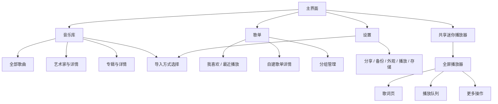
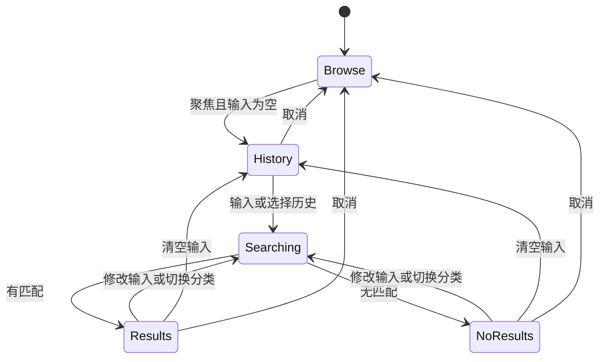
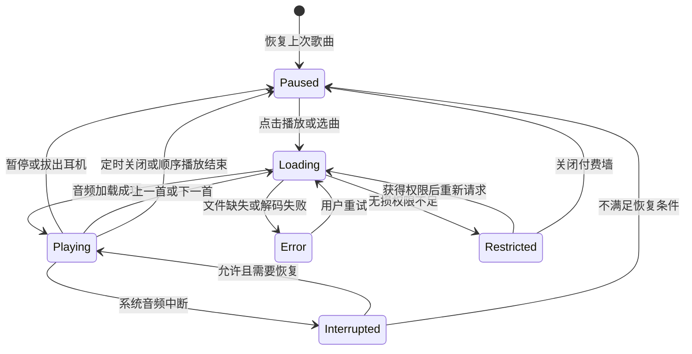

# TuneHaven 交互设计文档

> 版本：1.0 · 日期：2026-11-17 · 状态：目标交互规范，待原生实现与验收。
> 配套：[UI 设计文档](UI设计文档.md) · [产品需求](需求文档.md) · [日间效果](design/ui-concepts-2026-11-17/index.html) · [黑夜效果](design/ui-concepts-2026-11-17/dark.html)。

## 1. 范围与约定

本文覆盖三套候选主题共用的核心行为，包括导航、曲库、搜索、歌单、播放、歌词、主题、导入与异常恢复。三套方案只改变视觉表达；下列行为在云霞、晴屿、月晕及其日夜模式之间一致。

- **沿用**：既有 PRD 或代码已定义的行为，本轮保持。
- **调整**：新设计建议改变的界面行为，尚未实现。
- **补充**：为效果稿或已知缺口补足的目标规则，尚未实现。
- 文中未标注的新界面样式均属于目标设计，不代表已经接入功能。业务权限和数量限制以现有 PRD 为准。

本次不增加在线推荐、社区、账号体系、专辑收藏、歌词翻译、位深解析或自定义歌单封面功能。

## 2. 信息架构与导航

### 2.1 一级入口

- 沿用“音乐库／歌单／设置”三个 Tab，各自保留独立导航栈。切换不重置搜索、列表位置、筛选或播放。
- 调整为图标加文字的底栏，选中状态同时体现在符号、背景和可访问语义中。
- 再次点击当前 Tab 不触发额外业务，也不强制滚动到顶，避免改变现有使用预期。
- 根页面不展示返回按钮；子页面使用标准返回，保留系统边缘返回手势。

### 2.2 层级与关闭

| 层级 | 适用内容 | 退出行为 |
| --- | --- | --- |
| 当前 Tab 内导航 | 专辑、艺术家、歌单、分组、设置子页 | 返回上一层并恢复位置 |
| 全屏播放层 | 播放器；其内部切换歌词或队列 | 收起回到原 Tab 和原页面；播放继续 |
| Sheet | 创建／编辑、导入方式、倍速、定时、更多、歌词搜索 | 关闭当前任务，不隐式关闭播放器 |
| Alert／确认 | 删除歌曲、删除歌单、替换曲库 | 必须区分取消与明确动作 |
| 底部反馈 | 收藏、添加、删除撤销、可恢复错误 | 不阻断当前任务，避开播放控制与键盘 |

同一时间只推进一个需要操作的 sheet。由“更多”进入另一个 sheet 时先关闭前者再呈现后者，防止弹层落在播放器下面。外部备份打开继续沿用现有模态协调规则，详见第 12 节。

## 3. 全局状态与启动

### 3.1 启动与恢复

- 沿用恢复上次歌曲但不自动播放。存在有效歌曲时显示暂停态迷你播放器；无记录时不显示虚构歌曲。
- 无损播放权限在真正开始播放前检查；恢复界面不等于允许播放。
- 队列不持久化，不能在冷启动恢复出一份伪造的历史队列。恢复歌曲后如何构建可继续的上下文沿用播放服务。
- 空曲库首屏保留三个 Tab，音乐库显示“把喜欢的音乐带进来”与“导入音乐”。不自动请求文件、媒体库或相机权限。
- 加载本地数据时允许显示短暂骨架，加载完成后展示真实内容；不把加载状态误判为空曲库。

### 3.2 共享状态原则

歌曲、收藏、当前曲目、播放状态、播放进度、模式和歌词偏好只有一份真实状态。歌曲行、我喜欢、迷你播放器、全屏播放器、歌词页与队列同步更新，主题切换不会复制状态。

异步操作使用稳定的歌曲／歌单 ID。切换歌曲后到达的旧歌词或封面结果不得覆盖新歌曲。

## 4. 音乐库与搜索

### 4.1 页面操作

| 入口／动作 | 状态变化与结果 | 类型 |
| --- | --- | --- |
| 点击“全部／艺术家／专辑” | 保留当前搜索词，按该类别查询；不修改播放队列 | 沿用 |
| 点击艺术家／专辑 | 在当前 Tab 打开详情；返回保持原位置 | 沿用 |
| 点击歌曲主体 | 按所属列表上下文构建队列并播放，展开全屏播放器 | 沿用 |
| 点击当前歌曲行 | 调用现有播放入口并展开播放器；不把行点击定义为暂停 | 沿用 |
| 点击排序 | 展开六种排序菜单，再点当前排序项切换升降序；记住选择 | 沿用 |
| 格式筛选 | 只改变当前曲库显示；入口可收纳在排序／筛选菜单 | 沿用 |
| 右上角加号 | 展开导入方式选择；保留设置中的原导入入口 | 调整 |
| 点击继续听 | 对有效上次歌曲请求播放并展开；复用正常权限与缺失文件检查 | 补充 |

云霞“继续听”卡在没有有效恢复歌曲时隐藏。月晕专辑区使用“最近添加”，按专辑内最新导入歌曲时间聚合；不声称拥有不存在的专辑收藏状态。

### 4.2 搜索状态

- 音乐库输入停止 300 ms 后搜索；旧查询取消或失效，新结果不能被旧请求覆盖。
- 匹配歌名、艺术家、专辑，支持现有拼音全拼、首字母与容错；全部在本地完成，不显示“联网搜索”。
- 聚焦且为空显示当前分类的历史，每类最多 10 条；选择历史立即查询，支持删除单条与清空本类。
- 清除按钮只清空输入并保留焦点；“取消”退出搜索、收起键盘并恢复浏览状态。
- 切换类别时保持搜索词；艺术家分类只匹配艺术家字段，专辑分类只匹配专辑字段。
- 无结果显示“没有找到相关音乐”和“试试拼音首字母”，同时保留输入与返回途径。
- 搜索过程中收藏、添加到歌单或删除后刷新对应结果，不把用户突然带回列表顶部。
- 歌单详情搜索输入即过滤，搜索词非空时隐藏封面／简介，清空恢复头部；与音乐库的 300 ms 规则区分。
- 效果稿中的“搜索你的歌单”是新增目标：仅筛选本机可见歌单名称，分组作为归属信息，不搜索远端；不得误调用音乐库歌曲搜索。当前歌单首页尚无此入口，需要补充实现。

### 4.3 歌曲操作

右滑喜欢／取消喜欢；左滑按上下文显示“从音乐库删除”或“移出歌单”；长按和更多菜单提供同等操作，不能只靠手势。

- 收藏成功后同步“我喜欢”，以实心心形和可访问状态反馈；不弹确认。失败回滚并显示“收藏失败，请重试”。
- “下一首播放”插入当前曲后；成功才显示确认。队列满 999 首时补充“播放队列已满，请先移除一些歌曲”，禁止静默成功提示。
- “添加到歌单”打开现有选择器；已包含歌曲的目标给出状态，不能重复添加后还增加数量。
- 从音乐库删除需确认，完成后给 30 秒撤销；歌曲文件按现有延迟删除规则处理。移出自建歌单只解除关联，不删除源歌曲。
- 对缺失音频显示“未找到音频”；点击后说明可重新导入，不直接跳到付费墙或伪播放。

## 5. 歌单与分组

### 5.1 首页与详情

- “我喜欢”固定第一，“最近播放”随后；系统歌单不能删除、重命名或分享。
- 最近播放沿用时间范围设置，默认 7 天，最多加载 1000 首。卡片数字来自当前规则，不显示静态“24 首”。
- 自建歌单点击进入详情；重点卡的播放按钮以该歌单作为队列上下文，从首个可播放项开始请求播放。卡片主体只打开详情。
- 封面无图使用占位；自建歌单仍使用前四首封面拼图。自定义封面不在本轮默认开放。
- 空歌单显示“这个歌单还没有歌曲”与“添加歌曲”；空首页显示“创建第一个歌单”，不显示没有对应数据的重点卡。

### 5.2 新建、编辑与删除

1. 点击右上角加号，打开创建 sheet，聚焦名称；简介选填。
2. 名称去首尾空白，空名称或保留名“我喜欢／最近播放”不能保存，错误就近说明；不新增特殊字符限制。
3. 提交时防止重复点击；成功关闭 sheet 并让新歌单在列表可见，失败保留输入。
4. 编辑保留原始值以识别修改；有未保存修改时关闭需提示保留编辑或放弃，未修改直接关闭。已实现（`EditPlaylistSheet`：取消按钮确认 + `interactiveDismissDisabled`）。
5. 删除明确提示“删除歌单不会删除音乐库中的歌曲”，确认后处理；删除失败保留歌单，不先显示成功。

### 5.3 排序、分组与批量添加

- 歌单列表提供“编辑／排序”或更多菜单入口，再允许拖动，避免与竖向浏览冲突；补充可访问的上移／下移操作。
- “分组”进入管理页，支持新建、重命名、排序、移入／移出。删除分组只把组内歌单移回未分组，不删除歌单。
- 批量添加按艺术家分组，可搜索、全选／取消全选；已经在歌单中的项不可重复选择，显示原因而非只变灰。
- 提交按钮展示选中数量；零首时不可提交。异步失败保留选择，成功后更新歌单数量与拼图封面。
- 歌单内歌曲拖拽排序是现有已知缺口，不因本次视觉重设计自动宣称可用。

## 6. 迷你播放器

| 状态／操作 | 目标行为 |
| --- | --- |
| 没有当前歌曲 | 隐藏迷你播放器，底栏正常存在 |
| 有歌曲且暂停 | 显示播放图标与当前进度，不播放装饰动画 |
| 正在播放 | 显示暂停图标，进度与全屏一致 |
| 点击封面、标题或剩余主体 | 展开全屏播放器，保留当前播放状态 |
| 点击播放／暂停 | 仅切换状态，不能同时展开全屏 |
| 点击下一首 | 按当前模式前进，不能同时展开全屏 |
| 长标题／大字号 | 优先保留标题和播放；允许增高或减少次要信息 |

效果稿精简了现有迷你播放器的收藏按钮。落地目标保留封面、标题、播放／暂停、下一首与细进度；收藏在歌曲更多菜单和全屏播放器可达。空间充分时可保留收藏，但不得把点击区压到 44 pt 以下。此项是界面调整，不删除收藏能力。

列表底部预留空间应依据真实附件高度和安全区域计算，不能继续依赖固定 80 pt 在所有字号下都正确。

## 7. 全屏播放与状态转换

### 7.1 主要控制

- 播放／暂停、上下首调用共享播放服务。异步加载时用单一加载态反馈；防止快速连续点击启动相互覆盖的播放请求。
- 上一首沿用规则：当前已播放超过 3 秒，先回到本曲开头；否则上一首。下一首行为由当前模式决定。
- 模式按钮依次切换“顺序 → 单曲循环 → 列表循环 → 随机 → 顺序”，更新符号、可访问名称与简短状态提示。不是单独的随机开关。
- 随机和跳过权重沿用 PRD；不增加效果稿里没有的“不喜欢”按钮，不自行修改计数。
- 收藏与其他页面双向同步，失败可恢复；反馈不能遮住进度条和主播放键。

### 7.2 进度拖动

**调整目标**：视觉轨道为 4–6 pt，命中区域至少 44 pt。按下／拖动时展示预览时间，手指松开提交最终 seek；保留拖动前是播放还是暂停的状态。实现可以节流实时预听，但不能每个触摸事件都无条件重复解码。

- 结果限制在 0 到有效时长之间；没有有效时长时不可 seek，并读出“时长未知”。
- 触摸落在进度区域后，由进度手势处理，不触发播放器关闭。
- VoiceOver 提供可调整进度操作；不能让拖动成为唯一途径。
- 左侧显示已播放时间，右侧显示剩余时间；均来自播放引擎，不用效果稿固定数字。

### 7.3 展开、歌词与收起

- 点击收起返回原页面，不暂停、不重建队列。
- 封面／标题区域可下拖收起；短距离拖动回弹。初始可沿用代码的超过 100 pt 位移或超过 400 pt 的预测结束位移条件，随后按真机体验微调；预测位移不是速度值。
- 关闭拖动不覆盖滑杆、按钮、歌词竖向滚动与系统边缘手势。
- 点击歌词预览进入歌词页；没有歌词时显示“添加歌词”或“搜索歌词”的明确入口，保留本地导入和粘贴能力。
- 全屏播放与歌词切换过程共享当前曲，不因转场重载或重新开始播放。

### 7.4 更多与输出

- 更多入口包含现有定时关闭、倍速、添加到歌单、搜索／导入／删除歌词。已有歌词才显示删除歌词。
- 倍速为 0.5／0.75／1.0／1.25／1.5／1.75／2.0，显示当前选择；按全局／单曲记忆方式保存。
- 定时关闭为 15／30／45／60／90 分钟，可取消；更多入口可显示剩余时间，到点暂停。现有“结束前通知”存在未完成部分，不能声称已可通知。
- 音频输出为新增目标入口：打开系统 AirPlay／音频路由选择，显示实际设备名称；无外接设备不显示“AirPods Pro”。不自绘不可操作的设备菜单。
- 音质标签只展示真实已知数据，不承担订阅购买入口；受限播放通过统一权限流程处理。

### 7.5 播放队列

- 从播放器或歌词页打开队列，保留共用播放控制；关闭队列回到原播放视图，不改变播放进度。
- 当前项显示状态标记；点击任意队列项按 `.queue` 上下文播放，不重建为整个音乐库。
- 拖动排序保持当前曲目 ID，不能因索引变化切换音频；移除项只改变队列，不删除音乐库文件。
- “存为歌单”保存当前队列顺序，名称按第 5 节规则校验；成功后反馈歌单名称，失败不伪报已保存。
- 空队列显示“队列为空”，不显示可执行的保存／清空按钮。队列不跨冷启动持久化。
- **补充目标**：清空前说明只清空队列；当前音频继续到结束，之后停止且不自动重建列表。移除当前项时同样不突然切断音频，应标记为队列外播放；下一首从原后继项开始，无后继则停止。已实现：`PlaybackService.removeFromQueue(at:)` / `clearQueue()`，状态 `isPlayingOutsideQueue`；队列页顶部显示「队列外播放」标记与「播完后继续：…／播完后停止」。从音乐库删除正在播放的歌曲时文件已被移走，不适用队列外播放，改为立即切到后继项。

## 8. 歌词阅读

### 8.1 有时间轴歌词

- 自动定位当前行；当前行加重并按行内进度填充，左右对齐、字号与颜色按 UI 文档。
- 手动竖向滚动时暂停自动跟随，3 秒无进一步滚动后恢复；同时提供“回到当前句”按钮立即恢复。不能在手指仍拖动时抢回位置。
- 点击歌词行跳转到该行时间；保持原先播放／暂停状态。跳转后恢复跟随与当前行标记。
- 双指缩放沿用 0.8–2.0 范围；补充字号按钮作为替代。效果稿按钮不能只弹“已调整”，必须实际改变同一字号状态。
- “简体／原文”与设置中的歌词字形共用偏好，同时更新预览和歌词页；不额外承诺自动把简体转成繁体。
- 点击收起或右滑返回封面播放器；在非滚动区可下滑返回。歌词区的竖向手势优先阅读，不能轻扫就关闭。

已统一为右滑返回，PRD 已同步修订。跟随暂停按滚动阶段判断：手指拖动时暂停，停止（含惯性结束）3 秒后恢复，因此不会在手指仍按住时抢回位置。

### 8.2 其他歌词状态

| 状态 | 展示与动作 |
| --- | --- |
| 纯文本无时间轴 | 可滚动阅读、调整字号与字形；不逐行高亮，点击正文不 seek |
| 明确器乐曲 | 显示“器乐曲（无歌词）”，保留播放控制。**待实现**：器乐曲标记目前只存在于在线搜索结果，本地没有持久化字段，歌词页暂按“暂无歌词”处理 |
| 暂无歌词 | 显示“暂无歌词”，提供导入 LRC／粘贴；在线搜索标明 Premium |
| 正在匹配 | 只在歌词区域显示状态，播放继续；切歌后废弃旧结果 |
| 匹配失败 | 保留本地添加入口，说明“没有找到匹配歌词”；网络失败可重试 |
| 无在线权限 | 自动匹配静默跳过；用户主动搜索时才说明权益并打开付费墙 |

来源优先级与失败缓存沿用 PRD：内嵌 → 本地文件／手动 → 在线；自动匹配全部失败后 7 天内不重复请求，网络错误不计入该失败缓存。

## 9. 主题与系统日夜变化

**调整建议，待主题策略确认**：主题只决定云霞／晴屿／月晕色系，深浅外观跟随系统。三组画板是配对关系，不把它们误当六个收费档位。

1. 在设置的外观区域展示主题预览、名称和选中标记，不能只用色块区分。
2. 有权限的主题点击后立即生效并保存；返回曲库、全屏播放器及所有弹层同步更新。
3. 系统从日间切黑夜时，保持主题、曲目、时间、队列、搜索、滚动位置与当前弹层；只更新外观。
4. 锁定主题沿用现有权限检查；点击说明权益，不先把主题应用再回滚。
5. 购买成功沿用现有产品行为；是否自动应用刚才选中的主题须在正式主题方案确定时明确，不从原型推断。
6. 旧四主题与新三主题的 ID 映射、Premium 归属及恢复备份后的兼容处理尚待决策。禁止直接覆盖旧偏好造成不可恢复。

减少透明度、增强对比度与减少动态效果的变化必须立即影响所有主题；不为无障碍设置再次收费。

## 10. 导入音乐

新增音乐库加号入口与原设置入口共用导入流程，显示“文件导入／Apple Music／云盘／WiFi 传输／WebDAV”。选择某一种方式时再请求相关权限。

- 关闭系统文件选择器视为取消，不显示失败提示，也不清空原曲库。
- 支持格式、500 MB 单文件上限、SHA256 去重与 DRM 过滤沿用 PRD。
- 导入中显示当前文件、完成数／总数、进度和可可靠估计的剩余时间；估计不稳定时隐藏，不编造倒计时。
- 结果分别展示成功、重复跳过、格式不支持、超过大小和失败；部分成功不能整体标红为失败。
- Apple Music 导入关闭页面后按现有规则继续后台处理；不要把“关闭”写成“取消导入”。其他导入方式是否可取消，必须依据对应服务能力显示，不统一承诺。
- 成功后刷新歌曲数、艺术家、专辑与有关歌单视图；导入本身不自动播放。
- 文件缺失的元数据记录重新导入匹配音频后，沿用原记录并保留收藏等数据。
- WebDAV 无权限先打开权益说明；文件导入、云盘、WiFi、歌曲搜索不触发付费墙。

## 11. 错误、空状态与反馈

| 场景 | 用户可见结果 | 恢复入口 |
| --- | --- | --- |
| 曲库为空 | “还没有音乐” | 导入音乐 |
| 搜索无匹配 | “没有找到相关音乐” | 修改关键词，提示拼音首字母 |
| 没有自建歌单 | “创建第一个歌单” | 创建歌单 |
| 没有歌词 | “暂无歌词” | 导入／粘贴／在线搜索 |
| 音频未找到 | “未找到音频，请重新导入” | 导入入口，保留元数据记录 |
| 解码／播放失败 | “这首歌曲暂时无法播放” | 重试或由用户选择下一首 |
| 收藏／保存失败 | 说明具体动作失败 | 保留原状态或输入，可重试 |
| 队列已满 | “播放队列已满，请先移除一些歌曲” | 打开队列 |
| 网络歌词失败 | “歌词加载失败” | 重试或本地添加，播放继续 |
| 无损播放受限 | 说明当前歌曲需 Premium | 查看权益或关闭，保留可返回路径 |
| 相机／媒体库权限拒绝 | 说明无法执行的操作 | 前往系统设置或取消 |

- 保存与购买进行中，按钮使用加载态并防重复提交，不把所有页面一起锁住。
- 普通成功反馈可约 2 秒自动淡出；带关键恢复动作的提示不能过早消失，VoiceOver 应可发现。
- 删除撤销至少沿用 30 秒窗口；提示与播放附件错位排布。大字号和键盘弹出时仍可点击。
- 删除歌曲、歌单、歌词与替换曲库使用具体对象和动作，警告不能写成泛化的“确定吗”。
- 不新增模糊的“操作成功”，不把原型中的“演示”提示带入正式产品。

## 12. 分享、备份、订阅与中断

这些页面未绘制高保真效果，按新视觉体系延伸，业务仍沿用 PRD。

- 分享直传：同 WiFi、先选择内容再发送；扫码时才请求相机权限。发送／接收显示真实进度、结果与可操作的失败原因。
- WiFi 传输：显示服务器地址、二维码和停止入口；保留明文传输提示、可选密码与既有验证规则。
- 外部打开备份：按现有流程协调播放器及其他弹层，播放不中断；若收起期间用户主动打开新的播放器／付费墙，则不强行抢占，提示稍后从文件打开。
- 恢复备份：合并默认，替换曲库二次确认；只允许在复制阶段、写入曲库前取消。写入阶段明确“正在恢复，请稍候”，不能提供会造成半恢复的假取消。
- 恢复失败按服务回滚，报告失败原因；导入／恢复不能改变订阅状态或绕过 Premium 主题限制。
- 无损受限、锁定主题、WebDAV 与手动在线歌词共用权益流程；购买成功或恢复购买成功后关闭付费墙。不得在普通离线浏览中主动弹出。
- 后台播放、锁屏控制、耳机断开暂停及系统中断后的恢复沿用音频会话策略；界面重新激活后以引擎真实状态刷新，不擅自发起播放。
- 顺序播放结束或定时到点都回到暂停态；不因恢复 UI 再自动开始。

## 13. 手势、反馈和无障碍

| 操作 | 首选方式 | 等价可见入口 |
| --- | --- | --- |
| 歌曲上下文操作 | 长按、左右滑 | 更多按钮 |
| 收起播放器 | 封面区下拖 | 顶部收起按钮 |
| 返回封面播放器 | 歌词页右滑 | 顶部收起／返回按钮 |
| 调整歌词大小 | 双指缩放 | 字号按钮 |
| 调整队列／歌单顺序 | 排序态拖动 | 上移／下移可访问操作 |
| 调整播放时间 | 进度拖动 | VoiceOver 可调整动作 |

标准点击区至少 44 × 44 pt。点击反馈约 100–150 ms；展开／收起约 300–400 ms，优先系统转场。触感只用于明确成功或状态变化，不为每次进度更新振动。

VoiceOver 按标题、内容、主要动作顺序导航；图标按钮有名称与当前状态。播放时不持续朗读进度，只有用户调整时才播报结果。减少动态效果时停止装饰旋转和波形动画；减少透明度时使用实色，不隐藏功能。

## 14. 与当前工程的差异清单

| 目标差异 | 当前基线 | 落地约束 |
| --- | --- | --- |
| 日夜配对主题 | 现有四主题固定深浅 | 主题策略、迁移与权限待确认 |
| 图标加文字底栏 | `RootTabView` 自定义纯文字底栏 | 保持独立导航栈及共享播放 |
| 曲库与设置导入入口 | 已实现：两处复用 `ImportFilesView` 与统一来源路由 | 权限按选择时机申请，选择器取消不报错，进度与结果组件共用 |
| 继续听／最近添加 | 新效果稿的重点展示 | 只用已有本地数据，不增加推荐服务 |
| 歌单首页搜索 | 现有首页未提供 | 新增本地名称筛选，勿混淆歌单内歌曲搜索 |
| 精简迷你播放 | 当前有收藏与进度 | 进度保留，收藏可在其他入口访问 |
| 进度触控区／预览 | 已实现：触控区 44，拖动预览时间、松手提交 seek | 与关闭手势分离（进度条位于可下拖区域之外） |
| 歌词右滑返回 | PRD 左滑；代码右滑 | 本轮按右滑统一，并同步旧文档 |
| 歌词字号／字形工具 | 现有缩放与设置偏好 | 工具绑定同一状态；无假按钮 |
| 系统输出设备入口 | 已实现：`AudioOutputButton` 显示实际设备名并打开系统路由选择 | 不自绘设备菜单 |
| 音质展示 | 已实现：LOSSLESS 与真实采样率（`PlayerQualityTag`） | 元数据无位深，不显示 |
| 队列满反馈 | PRD 记录当前静默不生效 | 需要补充错误反馈，不能标为已实现 |
| 移除当前项／清空播放队列 | 已实现：播放服务协调队列外播放，队列页显示标记，清空前确认 | 界面调用 `PlaybackService` 而不是直接改队列 |

## 15. 交互验收场景

以下为实施后的验收要求，本次文档交付没有宣称已经执行原生测试。

| 编号 | 场景 | 通过标准 |
| --- | --- | --- |
| I-01 | 空曲库首次启动 | 三 Tab 保留，不申请无关权限，导入入口可达 |
| I-02 | 冷启动恢复 | 恢复上次歌曲、暂停态，不伪造队列 |
| I-03 | Tab／详情切换 | 返回保留位置，播放不受影响 |
| I-04 | 搜索快速连续改词 | 只显示最新查询，清除和取消语义不同 |
| I-05 | 无结果与拼音搜索 | 空态正确，现有匹配规则不回退 |
| I-06 | 收藏／删除／撤销 | 各页面同步；30 秒内可恢复删除 |
| I-07 | 迷你控制与主体点击 | 播放按钮不误展开，主体展开不重播 |
| I-08 | 模式和上下首 | 四模式符号正确，上一首 3 秒规则正确 |
| I-09 | 播放进度与关闭拖动 | 触控区不冲突，seek 后保持播放／暂停状态 |
| I-10 | 歌词滚动／定位／缩放 | 手动浏览不被抢回，3 秒后恢复，可手动回当前句 |
| I-11 | 纯文本／无歌词／器乐曲 | 不显示假同步，仍可播放及本地添加 |
| I-12 | 系统切换日夜 | 三主题所有可见层同步变色，业务状态不变 |
| I-13 | 无封面／长标题／大字号 | 不遮挡控制，信息与操作仍可达 |
| I-14 | 导入取消／部分失败／重复 | 不误报成功或整体失败，数量对应真实结果 |
| I-15 | 队列 999 首 | 添加失败有反馈，原队列完整 |
| I-16 | 无损／WebDAV／歌词权限 | 门禁一致，取消付费墙可回原任务 |
| I-17 | 系统中断与耳机拔出 | UI 跟随真实音频状态，无意外自动播放 |
| I-18 | 外部备份与模态竞争 | 不抢占新任务，写入中无假取消，失败回滚 |
| I-19 | VoiceOver／减少透明度／减少动态效果 | 无隐藏功能，状态可读，控制有替代入口 |

实施时以 [AppRouter](../TuneHaven/App/Navigation/AppRouter.swift)、[PlaybackService](../TuneHaven/Domain/Services/PlaybackService.swift) 与现有各业务服务作为唯一状态来源，避免在主题组件中另建一套播放、队列或订阅逻辑。
